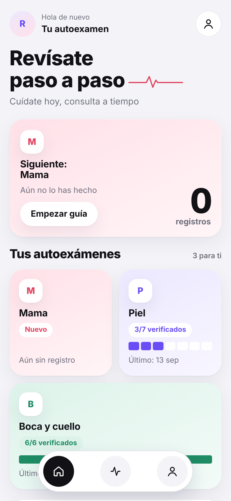
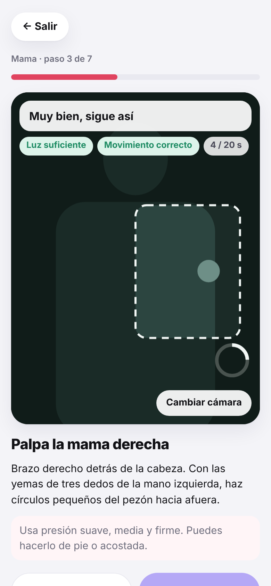
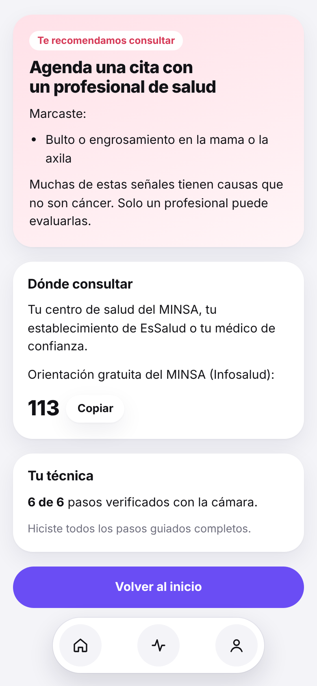

# Revísate

App web móvil que guía el autoexamen mensual de **mama, piel, testículos y boca**, y usa la cámara del celular para comprobar que cada paso se haga bien. No diagnostica: enseña la técnica y te dice cuándo consultar.

<p>
  
  
  
</p>

**Demo:** https://yasminbobbiov-1908.github.io/revisate/

## Qué hace

- **Perfil por sexo y anatomía:** muestra solo los autoexámenes que corresponden.
- **Guía con cámara:** un recuadro en pantalla indica dónde poner el cuerpo o las manos. La app verifica luz, quietud o movimiento en la zona correcta y tiempo mínimo antes de pasar al siguiente paso.
- **Checklist de signos de alarma** y derivación a consulta (MINSA, EsSalud, Infosalud 113).
- **Regla de las dos semanas** para lesiones en la boca.
- **Historial** con los pasos verificados en cada autoexamen.
- **Recordatorio mensual opcional.**
- Funciona sin conexión (PWA) y se puede instalar en el celular.

## Privacidad

La cámara se procesa cuadro por cuadro en el teléfono. **Ninguna imagen se graba ni se envía.** Los registros se guardan solo en el navegador (`localStorage`). La guía con cámara para mama y testículos solo se habilita para mayores de 18 años.

## Tecnología

HTML, CSS y JavaScript sin frameworks ni dependencias. Un solo `index.html`, un service worker (`sw.js`) y un manifiesto PWA. La detección usa diferencia de cuadros y brillo sobre una imagen de 64 × 48 píxeles.

## Probarlo en local

```bash
python3 -m http.server 8000
# abre http://localhost:8000
```

La cámara necesita HTTPS o `localhost`. En GitHub Pages funciona directamente.

## Publicar en GitHub Pages

1. Sube esta carpeta a un repositorio llamado `revisate`.
2. En **Settings → Pages → Build and deployment**, elige **GitHub Actions**.
3. Cada `push` a `main` publica la app (ver `.github/workflows/pages.yml`).

## Aviso

Prototipo educativo. No reemplaza la evaluación médica ni los tamizajes indicados para tu edad. Contenido basado en guías del INEN, NHS, Academia Americana de Dermatología, AAOMS, ADHA y Breastcancer.org.
